# 🚗 Rodagem: Sistema de Aluguel de Carros

Sistema web para efetuar, modificar, cancelar e avaliar pedidos de aluguel de automóveis pela internet, do pedido do cliente ao contrato executado por empresas e bancos.

<table>
  <tr>
    <td width="800px">
      <div align="justify">
        O <b>Rodagem</b> é o protótipo do <b>Laboratório 02</b> da disciplina de <i>Desenvolvimento e Integração de Aplicações Web</i> do curso de Engenharia de Software da PUC Minas. Clientes se cadastram, informam seus rendimentos e acompanham cada pedido em uma rota visual. Agentes, que podem ser empresas ou bancos, fazem a análise financeira e executam o contrato, que define em nome de quem o automóvel fica registrado.
      </div>
    </td>
    <td>
      <div>
        
      </div>
    </td>
  </tr>
</table>

---

## 🚧 Status do Projeto

       

---

## 📚 Índice
- [Links Úteis](#-links-úteis)
- [Sobre o Projeto](#-sobre-o-projeto)
- [Funcionalidades Principais](#-funcionalidades-principais)
- [Tecnologias Utilizadas](#-tecnologias-utilizadas)
- [Arquitetura](#-arquitetura)
- [Modelagem](#-modelagem)
- [Instalação e Execução](#-instalação-e-execução)
- [Deploy](#-deploy)
- [Estrutura de Pastas](#-estrutura-de-pastas)
- [Demonstração](#-demonstração)
- [Testes](#-testes)
- [Documentações utilizadas](#-documentações-utilizadas)
- [Autores](#-autores)
- [Contribuição](#-contribuição)
- [Agradecimentos](#-agradecimentos)
- [Licença](#-licença)

---

## 🔗 Links Úteis
* 📖 **Histórias de usuário:** [docs/modelos/v1/historias-de-usuario.md](docs/modelos/v1/historias-de-usuario.md)
* 📐 **Modelos UML:** [docs/modelos/v1](docs/modelos/v1)

---

## 📝 Sobre o Projeto

Alugar um carro envolve três partes com interesses diferentes: quem aluga, quem analisa o risco e quem formaliza o contrato. O Rodagem reúne essas partes em um único sistema acessível pela internet.

- **Problema:** pedidos, análises financeiras e contratos precisam seguir um fluxo único, com regras claras sobre quem pode fazer o quê em cada etapa.
- **Contexto:** projeto acadêmico do curso de Engenharia de Software da PUC Minas, avaliado pela adequação aos requisitos e pelo alinhamento entre modelos e código.
- **Valor entregue:** o cliente acompanha o status do pedido sem depender de contato direto. O agente decide com os dados financeiros do contratante na mesma tela.

### Fluxo do pedido

1. O cliente introduz o pedido, que nasce **em análise**.
2. Um agente escreve o parecer financeiro e **aprova** ou **reprova** o pedido.
3. Com parecer positivo, um agente executa o contrato e o pedido fica **contratado**.
4. O cliente pode **cancelar** enquanto o pedido estiver em análise ou aprovado.

### Tipos de contrato

| Tipo | Quem executa | Proprietário registrado do automóvel |
| :--- | :--- | :--- |
| Aluguel simples | Empresa | A empresa que executou o contrato |
| Aluguel com crédito | Banco, com contrato de crédito | O banco que concedeu o crédito |
| Aluguel com compra | Empresa ou banco | O cliente |

---

## ✨ Funcionalidades Principais

- 🔐 **Autenticação:** cadastro prévio e login com usuário e senha para clientes e agentes, com perfis de acesso.
- 👤 **CRUD de cliente:** RG, CPF, nome, endereço, profissão, entidades empregadoras e até 3 rendimentos.
- 📝 **Pedidos de aluguel:** introduzir, consultar, modificar e cancelar, com status visível em uma rota.
- 💰 **Análise financeira:** parecer do agente com os rendimentos do contratante.
- 📄 **Contratos:** execução por empresas e bancos, com registro do proprietário conforme o tipo de contrato.
- 🏦 **Contrato de crédito:** valor, juros mensais e parcelas, concedido por um banco agente.
- 🚘 **Automóveis:** matrícula, ano, marca, modelo, placa e proprietário.

---

## 🛠 Tecnologias Utilizadas

### 💻 Front-end

* **Biblioteca:** React 19 com React Router 7
* **Linguagem:** JavaScript (ES2022)
* **Estilização:** CSS próprio, com fontes Barlow e Barlow Condensed
* **Gerenciamento de Estado:** Context API e hooks
* **Build Tool:** Vite 8

### 🖥️ Back-end

* **Linguagem:** Java 25 (JDK)
* **Framework:** Spring Boot 4.0 (Web MVC, Data JPA, Validation, Security)
* **Build e dependências:** Apache Maven, com Maven Wrapper
* **Banco de Dados:** Supabase (PostgreSQL)
* **ORM:** Hibernate/JPA
* **Migrações:** Flyway
* **Autenticação:** Spring Security, JWT (HS256) e senhas com BCrypt

---

## 🏗 Arquitetura

O sistema segue o enunciado e se divide em dois subsistemas ligados pela internet:

- **Construção dinâmica das páginas web:** aplicação React que monta as telas a partir dos dados da API e do perfil do usuário.
- **Gestão de pedidos e contratos:** API REST em Spring Boot, organizada em **MVC**.

| Camada MVC | Pacote | Papel |
| :--- | :--- | :--- |
| **Model** | `model`, `repository`, `service` | Entidades JPA com as regras de cada objeto, persistência e casos de uso |
| **View** | `frontend`, `dto` | Telas React e representação JSON enviada a elas |
| **Controller** | `controller` | Recebe as requisições HTTP, valida a entrada e aciona os serviços |

### Padrões e decisões

- **Service Layer, Repository e DTO:** isolam as regras de negócio do HTTP e da persistência.
- **Modelo rico:** as transições de status ficam em `Pedido` e o limite de rendimentos fica em `Cliente`.
- **Herança JOINED:** `Usuario`, `Cliente`, `Agente`, `Empresa` e `Banco` têm tabelas próprias.
- **JWT sem sessão no servidor:** o front-end e a API podem ser hospedados separadamente.
- **Flyway com `ddl-auto: validate`:** o schema é versionado e o Hibernate confere o alinhamento com as entidades ao iniciar.
- **Row Level Security:** habilitado em todas as tabelas, pois o Supabase expõe o schema `public` por uma API própria. Apenas o back-end acessa os dados.

### Endpoints

| Método | Rota | Acesso | Descrição |
| :--- | :--- | :--- | :--- |
| POST | `/api/auth/login` | Público | Autentica e devolve o token |
| GET | `/api/auth/me` | Autenticado | Devolve a sessão atual |
| POST | `/api/clientes` | Público | Cadastra cliente |
| GET | `/api/clientes` | Agente | Lista clientes |
| GET | `/api/clientes/{id}` | Agente ou titular | Consulta cliente |
| PUT, DELETE | `/api/clientes/{id}` | Titular | Altera ou exclui cliente |
| POST | `/api/agentes` | Público | Cadastra empresa ou banco |
| GET | `/api/automoveis`, `/api/automoveis/{id}` | Autenticado | Lista ou consulta automóveis |
| POST | `/api/automoveis` | Agente | Cadastra automóvel |
| PUT, DELETE | `/api/automoveis/{id}` | Agente proprietário | Altera ou exclui automóvel |
| POST | `/api/pedidos` | Cliente | Introduz pedido |
| GET | `/api/pedidos`, `/api/pedidos/{id}` | Autenticado | Lista ou consulta pedidos |
| PUT | `/api/pedidos/{id}` | Cliente titular ou agente | Modifica pedido |
| POST | `/api/pedidos/{id}/cancelamento` | Cliente titular | Cancela pedido |
| POST | `/api/pedidos/{id}/avaliacao` | Agente | Registra parecer financeiro |
| POST | `/api/contratos` | Agente | Executa contrato |
| GET | `/api/contratos`, `/api/contratos/{id}` | Autenticado | Lista ou consulta contratos |

---

## 📐 Modelagem

Os diagramas ficam em [`docs/modelos/v1`](docs/modelos/v1), junto das [histórias de usuário](docs/modelos/v1/historias-de-usuario.md).

### Diagrama de Casos de Uso

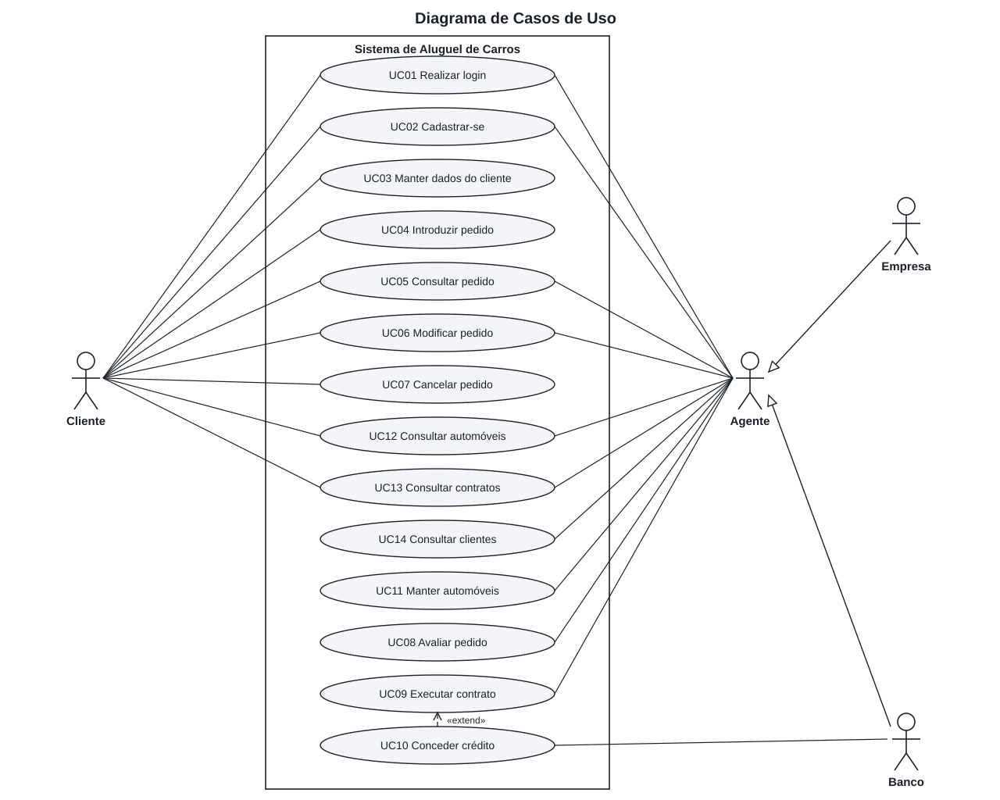

### Diagrama de Classes

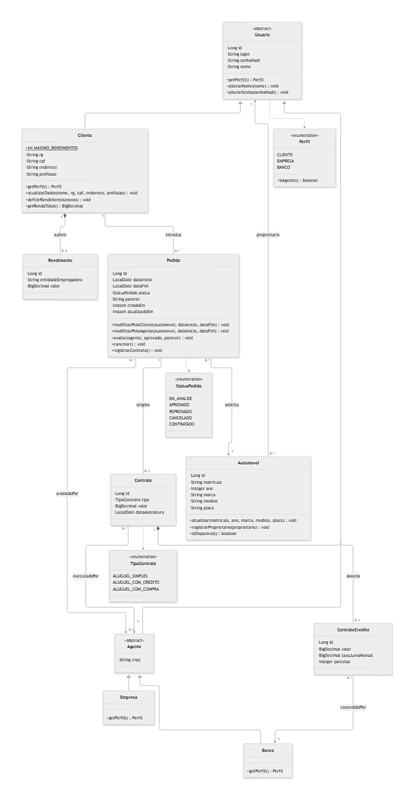

### Diagrama de Pacotes (Visão Lógica)

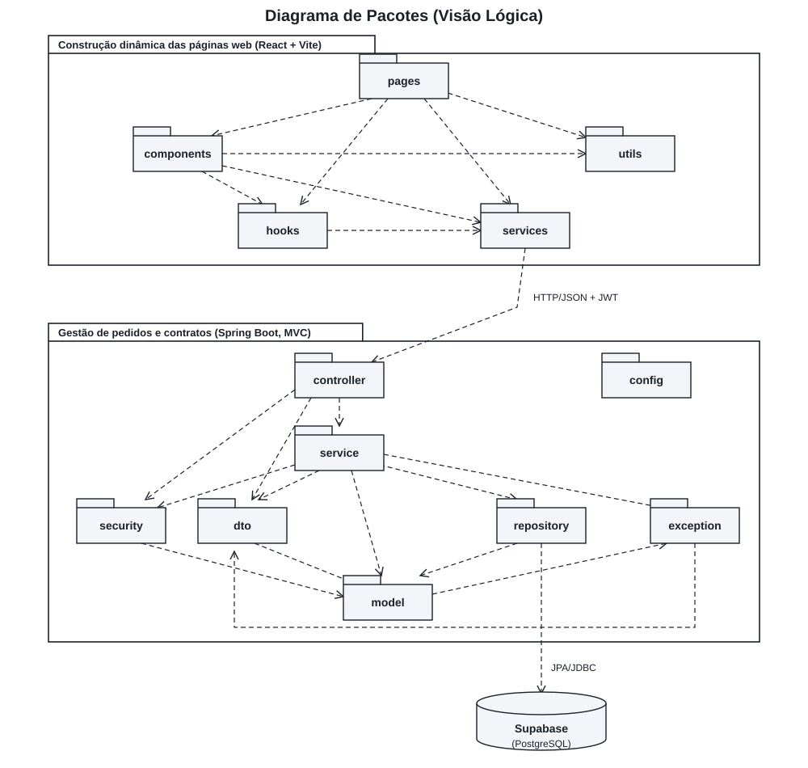

---

## 🔧 Instalação e Execução

### Pré-requisitos

* **Java JDK:** versão 25
* **Node.js:** versão 22 ou superior, com npm
* **Supabase:** um projeto criado em [supabase.com](https://supabase.com)

O Maven não precisa estar instalado, pois o projeto traz o Maven Wrapper.

### 🔑 Variáveis de Ambiente

#### 1 Back-end (Spring Boot)

Copie `backend/.env.example` para `backend/.env` e preencha os valores. No painel do Supabase, abra **Connect**, escolha **Session pooler** e use o host, a porta, o usuário e a senha exibidos.

| Variável | Descrição | Exemplo |
| :--- | :--- | :--- |
| `SPRING_DATASOURCE_URL` | URL JDBC do Session pooler do Supabase | `jdbc:postgresql://aws-0-sa-east-1.pooler.supabase.com:5432/postgres?sslmode=require` |
| `SPRING_DATASOURCE_USERNAME` | Usuário do banco | `postgres.abcdefghijkl` |
| `SPRING_DATASOURCE_PASSWORD` | Senha do banco | `sua-senha` |
| `JWT_SECRET` | Chave de assinatura dos tokens, com 32 caracteres ou mais | `uma-chave-aleatoria-e-longa` |
| `CORS_ORIGINS` | Origens do front-end, separadas por vírgula | `http://localhost:5173` |
| `SERVER_PORT` | Porta da API, opcional | `8080` |

#### 2 Front-end (React, Vite)

Copie `frontend/.env.example` para `frontend/.env`.

| Variável | Descrição | Exemplo |
| :--- | :--- | :--- |
| `VITE_API_URL` | URL base da API | `http://localhost:8080/api` |

### 📦 Instalação de Dependências

```bash
git clone https://github.com/RafaelCardoso25/Lab02-Sistema-Aluguel-Carros.git
cd Lab02-Sistema-Aluguel-Carros
```

#### Front-end (React)

```bash
cd frontend
npm install
```

#### Back-end (Spring Boot)

```bash
cd backend
./mvnw clean install
```

No Windows, use `.\mvnw.cmd` no lugar de `./mvnw`.

### 💾 Inicialização do Banco de Dados (PostgreSQL)

O Flyway cria as tabelas e habilita o Row Level Security quando o back-end inicia. Nenhum script manual é necessário.

### ⚡ Como Executar a Aplicação

#### Terminal 1: Back-end (Spring Boot)

```bash
cd backend
./mvnw spring-boot:run
```

A API fica disponível em **http://localhost:8080**.

#### Terminal 2: Front-end (React, Vite)

```bash
cd frontend
npm run dev
```

O sistema fica disponível em **http://localhost:5173**.

### Primeiro uso

1. Crie um cadastro do tipo **Empresa** e cadastre automóveis.
2. Crie um cadastro do tipo **Cliente** e faça um pedido.
3. Entre novamente como **Empresa**, avalie o pedido e execute o contrato.
4. Crie um cadastro do tipo **Banco** para testar o aluguel com crédito.

---

## 🚀 Deploy

1. **Build dos dois artefatos:**

```bash
cd frontend
npm run build
cd ../backend
./mvnw clean package
```

2. **Variáveis de ambiente:** configure no provedor as variáveis do back-end, com `CORS_ORIGINS` apontando para o endereço do front-end, e defina `VITE_API_URL` com a URL pública da API antes do build do front-end.

3. **Execução em produção:**

```bash
java -jar backend/target/aluguel-carros-1.0.0.jar
```

Os arquivos de `frontend/dist` são estáticos e podem ser servidos pela Vercel, pelo Netlify ou por outro servidor web.

---

## 📂 Estrutura de Pastas

```
.
├── README.md                      # 📘 Documentação principal do projeto.
├── LICENSE                        # ⚖️ Licença do projeto.
├── .gitignore                     # 🧹 Arquivos não versionados.
├── docs
│   ├── logo.svg                   # 🖼️ Logo do projeto.
│   ├── modelos/v1                 # 📐 Diagramas UML e histórias de usuário.
│   └── telas                      # 🖥️ Capturas de tela.
├── frontend                       # 📁 Aplicação React + Vite
│   ├── .env.example               # 🧩 Variáveis de ambiente do front-end.
│   ├── index.html
│   ├── package.json
│   └── src
│       ├── components             # 🧱 Componentes reutilizáveis.
│       ├── hooks                  # 🎣 Sessão e carregamento de dados.
│       ├── pages                  # 📄 Páginas da aplicação.
│       ├── services               # 🔌 Chamadas HTTP à API.
│       ├── styles                 # 🎨 Estilos globais.
│       └── utils                  # 🛠️ Formatação e rótulos.
└── backend                        # 📁 Aplicação Spring Boot
    ├── .env.example               # 🧩 Variáveis de ambiente do back-end.
    ├── mvnw, mvnw.cmd             # 🛠️ Maven Wrapper.
    ├── pom.xml                    # 🛠️ Build e dependências.
    └── src
        ├── main/java/br/pucminas/aluguelcarros
        │   ├── config             # 🔧 Segurança, JWT e CORS.
        │   ├── controller         # 🎮 Endpoints REST.
        │   ├── dto                # ✉️ Objetos de entrada e saída.
        │   ├── exception          # 💥 Exceções e tratamento global.
        │   ├── model              # 🧬 Entidades e regras de domínio.
        │   ├── repository         # 🗄️ Repositórios JPA.
        │   ├── security           # 🛡️ Geração de token e usuário autenticado.
        │   └── service            # ⚙️ Casos de uso.
        ├── main/resources
        │   ├── application.yml    # ⚙️ Configuração da aplicação.
        │   └── db                 # 📜 Migrações Flyway.
        └── test                   # 🧪 Testes de integração.
```

---

## 🎥 Demonstração

### 🌐 Aplicação Web

| Login | Novo pedido |
| :---: | :---: |
| 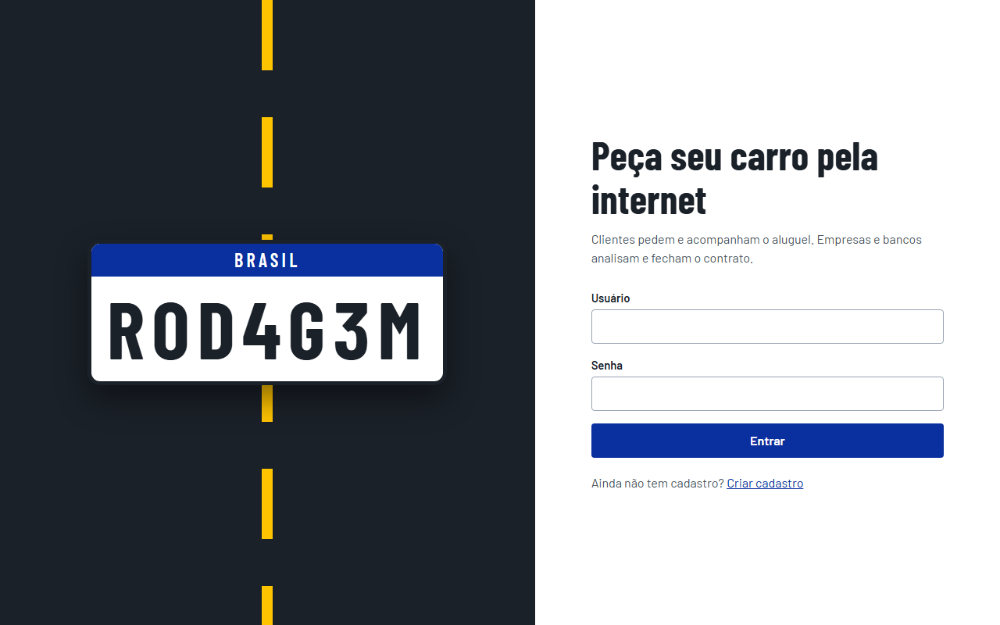 | 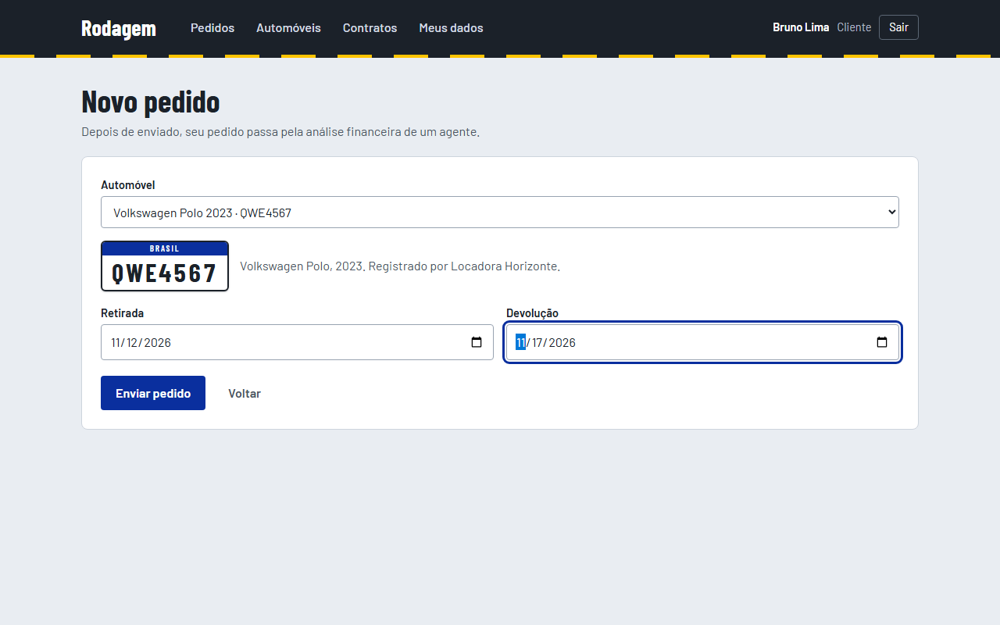 |
| **Pedido em análise (cliente)** | **Análise financeira (agente)** |
| 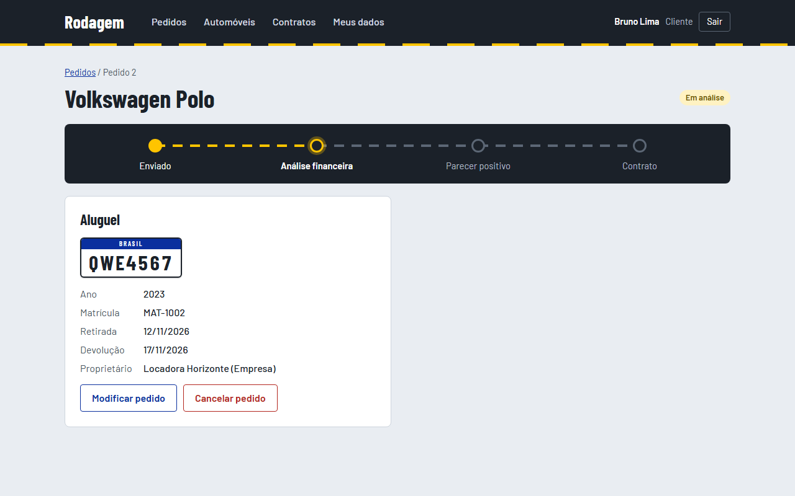 | 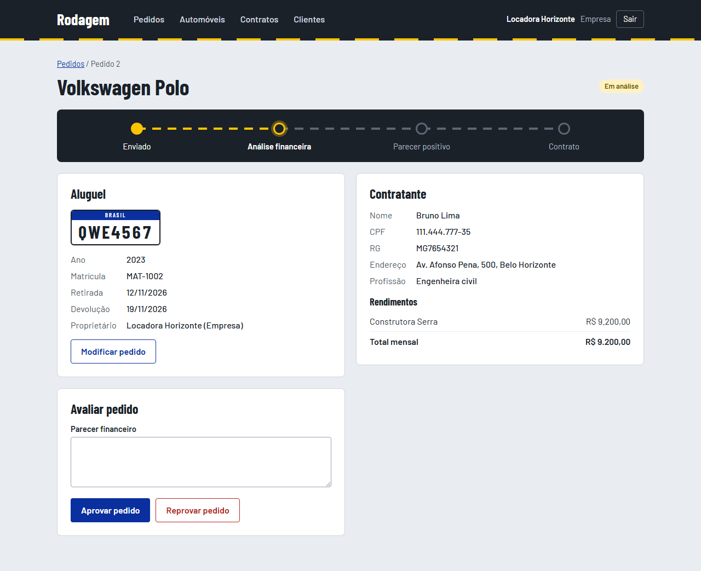 |
| **Pedido contratado** | **Lista de pedidos (agente)** |
| 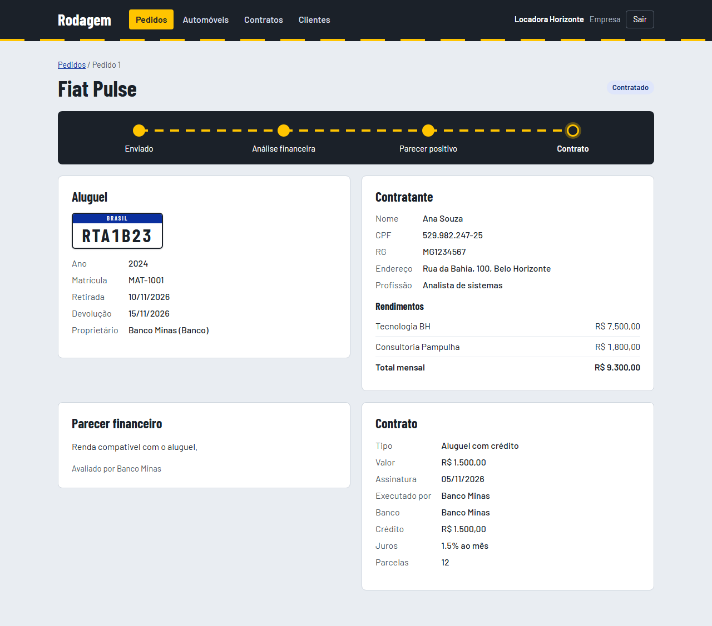 | 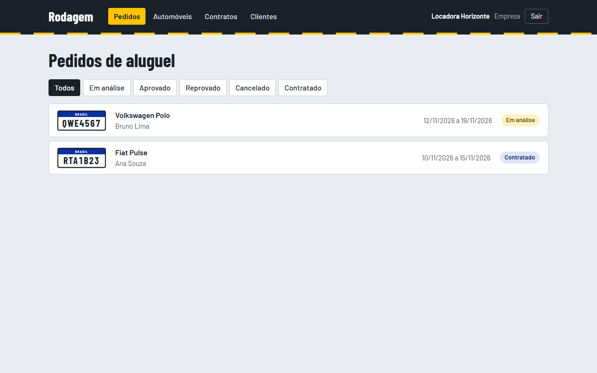 |
| **Automóveis** | **Contratos** |
| 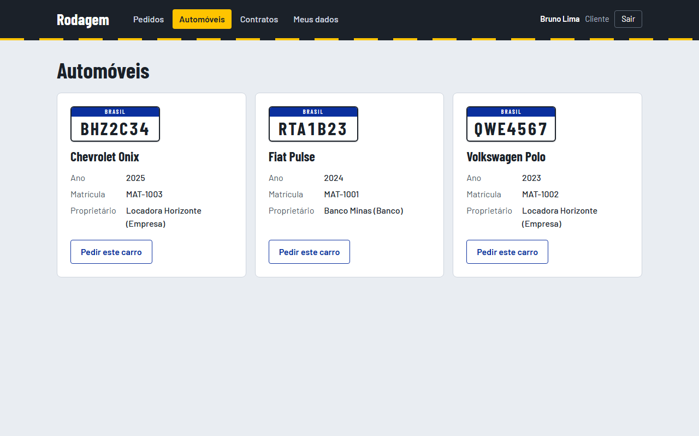 | 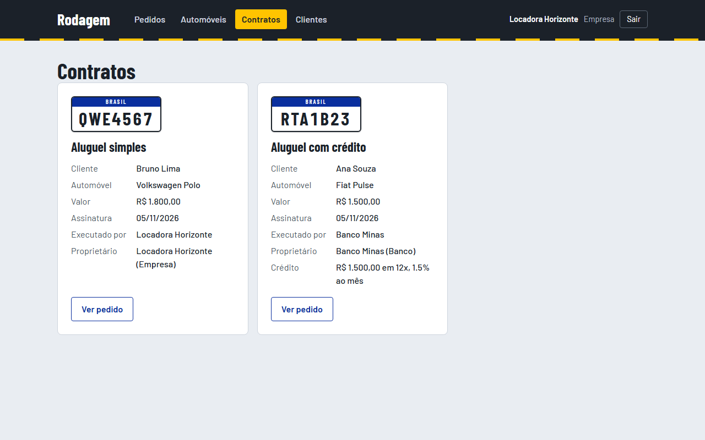 |
| **Cadastro** | **Meus dados** |
| 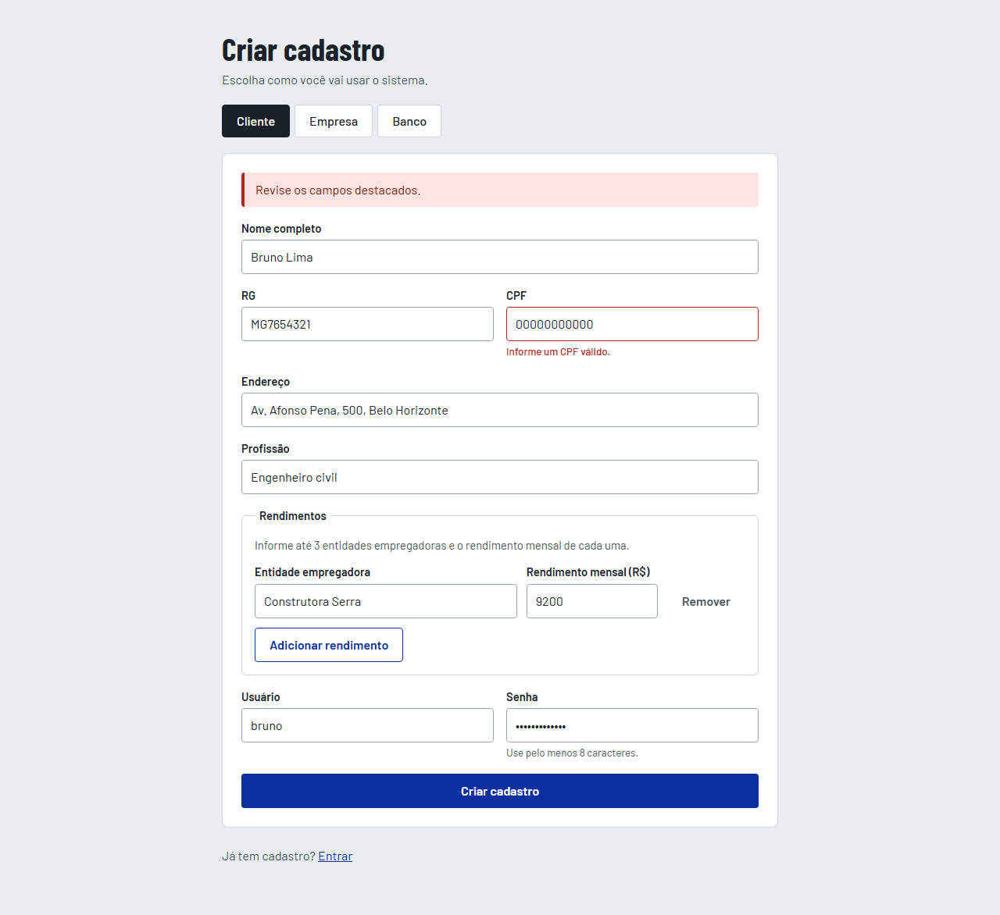 | 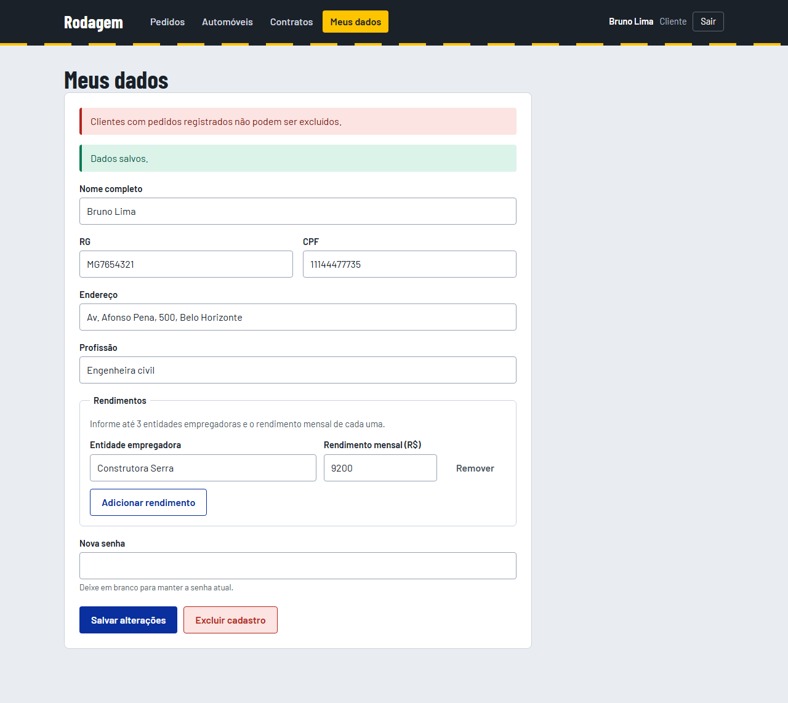 |

### 💻 Exemplo de Saída no Terminal

```bash
curl -X POST 'http://localhost:8080/api/auth/login' \
     -H 'Content-Type: application/json' \
     -d '{"login":"ana","senha":"senha-forte-1"}'
```

**Saída esperada:**

```json
{
  "token": "<jwt>",
  "id": 3,
  "nome": "Ana Souza",
  "perfil": "CLIENTE"
}
```

---

## 🧪 Testes

Os testes de integração percorrem autenticação, CRUD de cliente, permissões por perfil, automóveis e o fluxo completo do pedido até o contrato. Eles usam H2 em memória e não precisam de conexão com o Supabase.

```bash
cd backend
./mvnw test
```

*Ferramentas utilizadas: JUnit 5, Spring MockMvc e H2.*

---

## 🔗 Documentações utilizadas

* 📖 [**React**](https://react.dev/reference/react)
* 📖 [**Vite**](https://vitejs.dev/config/)
* 📖 [**Spring Boot**](https://docs.spring.io/spring-boot/)
* 📖 [**Spring Security**](https://docs.spring.io/spring-security/reference/)
* 📖 [**Supabase**](https://supabase.com/docs)
* 📖 [**Flyway**](https://documentation.red-gate.com/flyway)
* 📖 [**Mermaid**](https://mermaid.js.org/)

---

## 👥 Autores

| 👤 Nome | :octocat: GitHub |
|---------|-----------------|
| Rafael Cardoso | [RafaelCardoso25](https://github.com/RafaelCardoso25) |

---

## 🤝 Contribuição

1. Faça um `fork` do projeto.
2. Crie uma branch para sua feature (`git checkout -b feature/minha-feature`).
3. Faça o commit das mudanças (`git commit -m 'feat: adiciona nova funcionalidade'`), seguindo [Conventional Commits](https://www.conventionalcommits.org/en/v1.0.0/).
4. Envie a branch (`git push origin feature/minha-feature`).
5. Abra um **Pull Request**.

---

## 🙏 Agradecimentos

* [**Engenharia de Software PUC Minas**](https://www.instagram.com/engsoftwarepucminas/), pelo apoio institucional e pela estrutura acadêmica.
* [**Prof. Dr. João Paulo Aramuni**](https://github.com/joaopauloaramuni), pelos ensinamentos e pelo template deste README.

---

## 📄 Licença

Este projeto é distribuído sob a **[Licença MIT](LICENSE)**.
